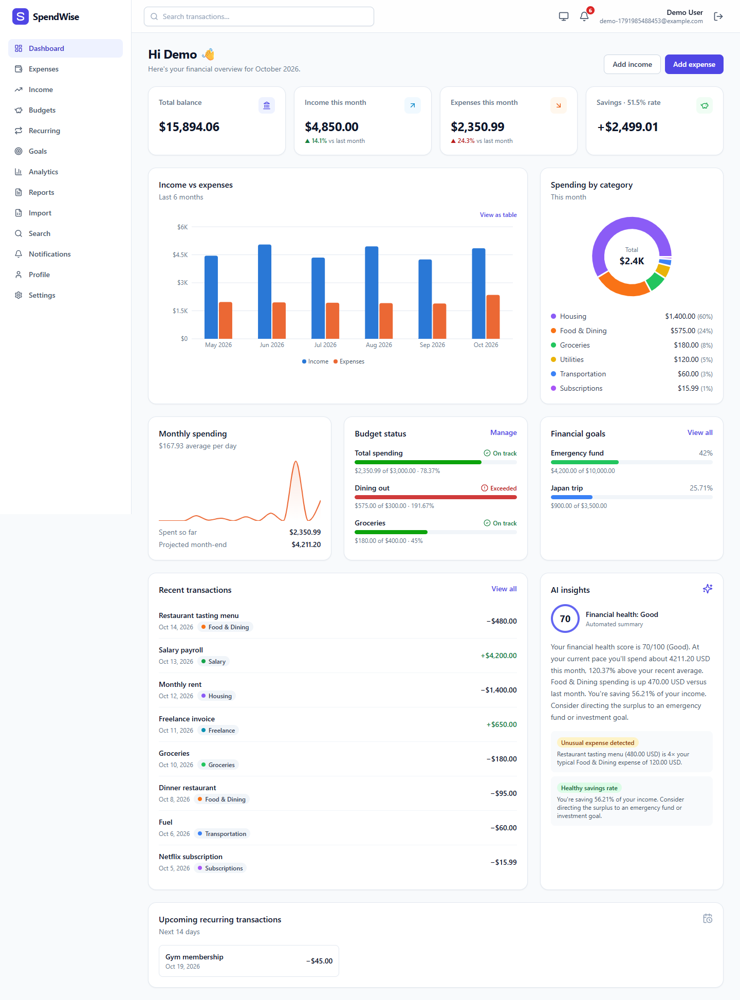
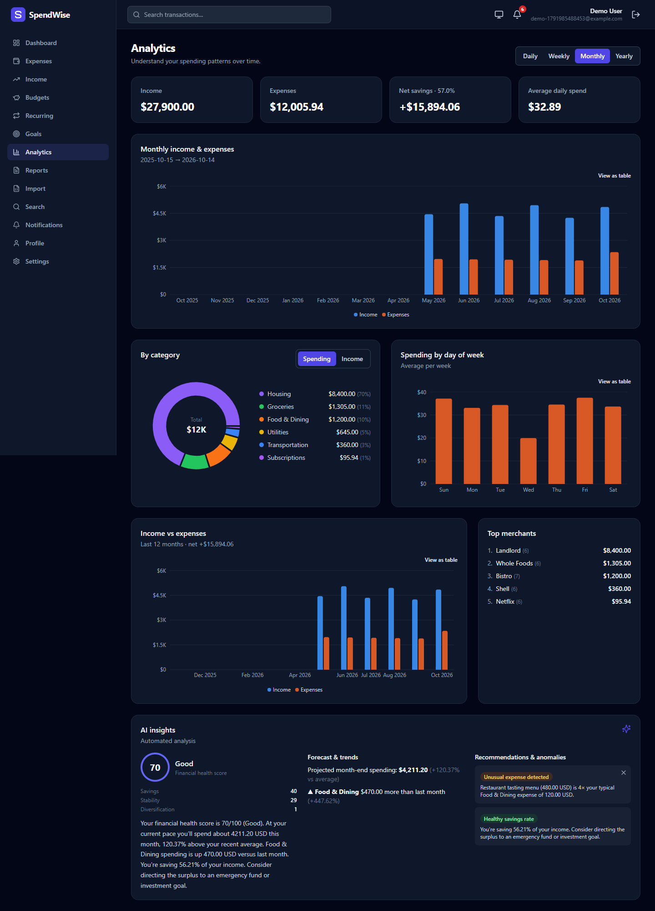
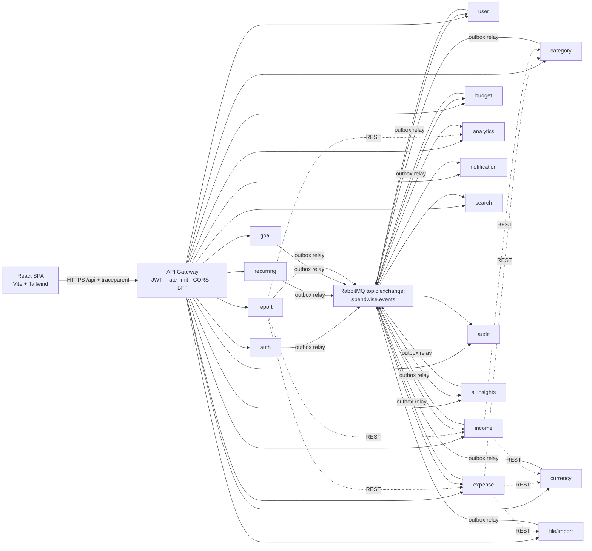

# SpendWise

**A distributed, event-driven personal finance platform: 17 Node.js microservices, a React dashboard, PostgreSQL (database-per-service), RabbitMQ, Redis, OpenTelemetry, Docker, Kubernetes (Helm), GitHub Actions and Argo CD.**

Track expenses and income, set budgets that warn you before you overspend, automate recurring transactions, save towards goals, import bank statements, export PDF/CSV/Excel reports, search everything, and get AI-powered insights (anomaly detection, forecasts, recommendations, and an optional Claude-written summary).

| Dashboard (light) | Analytics (dark) |
|---|---|
|  |  |

Regenerate the screenshots with `node frontend/e2e/screenshots.mjs docs/screenshots` while the stack is running. The script seeds a demo account through the public API.

---

## Architecture at a glance



Every service owns its own PostgreSQL database (16 databases, 16 roles; the gateway is stateless). No service can connect to another service's database. Services integrate in only two ways:

* **Synchronous REST** for queries that need an immediate answer, such as validating a category, converting a currency, or checking receipt ownership. Calls carry a timeout, a retry policy and a circuit breaker.
* **Asynchronous events** over RabbitMQ for everything else. Delivery uses the **transactional outbox** pattern plus **idempotent consumers**, with delayed **retries**, **dead-letter queues**, and **correlation IDs** and **W3C trace context** carried end to end.

### The expense workflow

```mermaid
sequenceDiagram
  participant UI as React
  participant GW as API Gateway
  participant EX as Expense Service
  participant DB as expenses DB
  participant MQ as RabbitMQ
  UI->>GW: POST /api/v1/expenses (JWT, traceparent, x-correlation-id)
  GW->>EX: proxy (JWT re-verified)
  EX->>EX: REST: category-service (auto-categorize), currency-service (FX)
  EX->>DB: BEGIN; INSERT expense; INSERT outbox(ExpenseCreated); COMMIT
  EX-->>UI: 201 Created
  EX->>MQ: outbox relay publishes ExpenseCreated (publisher confirms)
  par fan-out
    MQ->>Budget: usage → BudgetWarning / BudgetExceeded
    MQ->>Analytics: update read model, bust Redis cache
    MQ->>Notification: in-app + email (recurring/alerts)
    MQ->>AI Insights: robust anomaly detection → AnomalyDetected
    MQ->>Audit: hash-chained, append-only log
    MQ->>Search: full-text index
  end
```

A single click in the browser can be followed in **Jaeger** from the frontend through the gateway and the expense service, across RabbitMQ, and into every consumer. The same correlation ID shows up in the structured logs and in the audit log.

---

## The 17 microservices

| # | Service | Port | Responsibility | Publishes | Consumes |
|---|---|---|---|---|---|
| 1 | **api-gateway** | 8080 | Edge routing, JWT verification + revocation check, Redis rate limiting, CORS, header sanitising, dashboard BFF aggregation, aggregated Swagger | – | – |
| 2 | **auth-service** | 4001 | Registration, login with lockout, RS256 JWT + JWKS, rotating refresh tokens with reuse detection, sessions, password reset/change | UserRegistered, UserLoggedIn, LoginFailed, UserLoggedOut, PasswordResetRequested, PasswordChanged | UserProfileUpdated |
| 3 | **user-service** | 4002 | Profile & preferences (base currency, timezone, locale…) | UserProfileUpdated | UserRegistered |
| 4 | **expense-service** | 4003 | Expense system of record, FX conversion, optimistic concurrency | ExpenseCreated/Updated/Deleted | RecurringTransactionDue, ImportBatchReady, Category*, User* |
| 5 | **income-service** | 4004 | Income system of record | IncomeCreated/Updated/Deleted | RecurringTransactionDue, ImportBatchReady, Category*, User* |
| 6 | **category-service** | 4005 | Built-in + custom categories, keyword auto-categorization | CategoryCreated/Updated/Deleted | – |
| 7 | **budget-service** | 4006 | Weekly/monthly/yearly budgets, usage, projections, alerts once per period | BudgetCreated, BudgetWarning, BudgetExceeded | Expense*, Category*, User* |
| 8 | **recurring-service** | 4007 | Recurring rules + horizontally-safe scheduler (`SKIP LOCKED`) with catch-up | RecurringTransactionCreated, RecurringTransactionDue | Category* |
| 9 | **goal-service** | 4008 | Savings goals, contributions, milestones, required-monthly & on-track analytics | GoalCreated, GoalContributionAdded, GoalMilestoneReached | User* |
| 10 | **analytics-service** | 4009 | CQRS read model: summaries, trends (day/week/month/year), categories, patterns | – | Expense*, Income*, Category* |
| 11 | **notification-service** | 4010 | In-app inbox + email (SMTP), preferences, templates | – | 15 event types |
| 12 | **report-service** | 4011 | Async PDF/CSV/XLSX reports (CSV-injection safe) | ReportRequested, ReportGenerated, ReportFailed | ReportRequested |
| 13 | **search-service** | 4012 | PostgreSQL full-text (weighted tsvector) + trigram search with facets & suggest | – | Expense*, Income*, Category* |
| 14 | **currency-service** | 4013 | Currencies, ECB rates (Frankfurter) with offline fallback, historical conversion, Redis cache | ExchangeRatesUpdated | – |
| 15 | **audit-service** | 4014 | Tamper-evident (SHA-256 hash chain) append-only audit log, enforced by DB triggers | – | **all** (`#`) |
| 16 | **ai-service** | 4015 | Robust (median/MAD) anomaly detection, forecasts, trends, health score, recommendations, optional Claude narrative | AnomalyDetected | Expense*, Income*, Category* |
| 17 | **file-service** | 4016 | Receipt uploads (magic-byte verified), CSV/XLSX import with validation | ReceiptUploaded, ImportBatchReady, FileImported | – |

The full event catalog, with every producer and consumer, is in [docs/events.md](docs/events.md).

---

## Tech stack

| Layer | Choice |
|---|---|
| Frontend | React 18, Vite, Tailwind CSS, TanStack Query, React Router, Recharts, lucide icons |
| Services | Node.js 22, Express 5, zod (validation → OpenAPI), pino, prom-client, OpenTelemetry |
| Data | PostgreSQL 16 (database-per-service, SQL migrations), Redis 7 (cache, rate limiting, token deny-list) |
| Messaging | RabbitMQ 3.13 topic exchange; outbox/inbox; TTL retry queues; DLQ |
| AI | Explainable statistics; optional Claude (`claude-opus-5-5`) narrative via `@anthropic-ai/sdk` |
| Observability | OpenTelemetry → Collector → Jaeger; Prometheus + alert rules; Grafana dashboard; JSON logs |
| Delivery | Docker (multi-stage, non-root), Docker Compose, Helm chart, Argo CD, GitHub Actions |
| Testing | Vitest + Supertest (unit/API), integration tests on real Postgres/RabbitMQ, Node test runner system E2E, Playwright |

---

## Quick start (Docker Compose)

Requirements: Docker Desktop with about 8 GB of memory, and Node.js 22.

```bash
npm install                 # optional: only needed for running tests/tools locally
npm run secrets:generate    # optional: strong random secrets + RSA key in .env
docker compose up -d --build
```

| URL | What |
|---|---|
| http://localhost:3000 | SpendWise app |
| http://localhost:8080/docs | Aggregated Swagger UI for all services |
| http://localhost:16686 | Jaeger (distributed traces) |
| http://localhost:3001 | Grafana (admin / `admin-dev`). Dashboard: *SpendWise — Microservices Overview* |
| http://localhost:9090 | Prometheus |
| http://localhost:15672 | RabbitMQ management (spendwise / `spendwise-dev`) |
| http://localhost:8025 | Mailpit, which catches every email (password resets, budget alerts) |

If ports 5432, 6379 or 5672 are already taken by local installs, set `POSTGRES_HOST_PORT`, `REDIS_HOST_PORT` or `RABBITMQ_HOST_PORT` in `.env`.

Dead-lettered events can be replayed after a fix with `node scripts/replay-dlq.mjs <service-name>`. This is safe because consumers are idempotent.

The first user registered with `admin@spendwise.local` gets the admin role, which unlocks audit-chain verification, system status and the manual FX refresh.

To enable Claude-written insights, set `ANTHROPIC_API_KEY` in `.env`. Without a key the AI service uses a deterministic template, so the feature never hard-depends on an external API.

### Local development without containers

```bash
npm run infra:up                                   # Postgres, RabbitMQ, Redis, Mailpit, Jaeger, Grafana...
cd services/expense-service && npm run dev          # each service reads env vars (see docker-compose.yml)
cd frontend && npm run dev                          # http://localhost:5173 (proxies /api to :8080)
```

---

## Testing

| Level | Command | What it covers |
|---|---|---|
| Unit + API | `npm run test:unit` | Domain logic (budget periods, recurrence, anomaly detection, FX math, hash chain, CSV injection…), routing, validation, auth and error handling of every service via Supertest |
| Integration | `npm run test:integration` (needs `TEST_DATABASE_URL`, `TEST_RABBITMQ_URL`) | Outbox → RabbitMQ → idempotent consumer, retries, de-duplication; repositories on real PostgreSQL (refresh-token reuse detection, budget alerts once per period, scheduler catch-up, full-text search, append-only audit triggers) |
| System E2E | `npm run test:e2e` (stack running) | Full journey through the gateway, including asynchronous flows (BudgetWarning → notification), correlation ID → audit log, tenant isolation, imports, reports, token rotation and revocation |
| Browser E2E | `npm run test:e2e --workspace=frontend` | Playwright user journey in Chromium |

---

## Kubernetes & GitOps

```bash
# Render / install with Helm
helm install spendwise kubernetes/helm/spendwise -n spendwise --create-namespace -f kubernetes/helm/spendwise/values-dev.yaml

# GitOps: let Argo CD manage dev + prod from Git
kubectl apply -n argocd -f kubernetes/argocd/project.yaml
kubectl apply -n argocd -f kubernetes/argocd/root-app.yaml
```

The chart renders Deployments, Services, ConfigMap, Secret (or `existingSecret`), Ingress (TLS via cert-manager), HPAs (CPU and memory), PDBs, PVCs, NetworkPolicies (default-deny), startup/liveness/readiness probes, hardened security contexts (non-root, read-only root FS, all capabilities dropped, seccomp), plus optional in-cluster Postgres, RabbitMQ, Redis, Mailpit, OTel Collector, Jaeger, Prometheus (Kubernetes service discovery) and Grafana. See [docs/deployment.md](docs/deployment.md).

**CI/CD** (`.github/workflows/ci-cd.yml`): checkout → install → lint → unit tests → integration tests (Postgres and RabbitMQ service containers) → security scan (npm audit, gitleaks, Trivy fs/IaC; CodeQL SAST in its own workflow) → Helm lint + kubeconform → Docker build (matrix of 18 images) → Trivy container scan → push to GHCR → **GitOps commit** of the new image tag, which Argo CD syncs automatically.

---

## Security (OWASP)

The measures below are summarized here; the full OWASP Top 10 mapping is in [docs/security.md](docs/security.md).

* **Passwords:** argon2id with OWASP parameters, a password policy, account lockout, and constant-time behaviour for unknown emails.
* **Tokens:** RS256 access tokens (15 min) verified via JWKS at the gateway *and* in every service. Refresh tokens are opaque, rotating, stored hashed, delivered in an httpOnly SameSite=Strict cookie, and protected by reuse detection that revokes the whole family. Access tokens are deny-listed on logout.
* **Authorization:** every query is scoped by the user ID from the verified token (no IDOR). Admin routes are role-guarded. `/internal/*` endpoints need a timing-safe service token and are never routed by the gateway. Spoofed internal headers are stripped at the edge.
* **Input validation:** strict zod schemas on every endpoint (unknown fields rejected where it matters), parameterised SQL only, and LIKE-wildcard escaping.
* **Output handling:** React output escaping, HTML-escaped email templates, CSV/Excel formula-injection neutralisation, and a strict CSP on the SPA.
* **Uploads:** files are verified by magic bytes, size-limited, given sanitised names, stored outside the web root under server-generated keys, and downloads are path-traversal guarded with `nosniff` and a `sandbox` CSP.
* **Rate limiting and headers:** rate limits are global, per user, and strict on auth endpoints. Helmet security headers, CORS allow-list.
* **Errors and secrets:** errors never leak internals (the request ID is returned instead). Logs redact tokens and passwords. Secrets come only from environment variables or Kubernetes Secrets, and services refuse to start in production with development secrets.
* **Audit:** a tamper-evident audit log of every domain event, with secrets redacted before storage.

---

## Repository layout

```
spendwise/
├── frontend/                 React SPA (+ nginx.conf, Dockerfile, Playwright e2e)
├── services/                 17 microservices: src/, migrations/, tests/, Dockerfile each
├── shared/common/            Platform library: config, logging, tracing, metrics, HTTP, auth,
│                             validation→OpenAPI router, outbox/inbox messaging, migrations
├── infrastructure/postgres/  Database-per-service bootstrap
├── kubernetes/               Helm chart (values-dev/prod) + Argo CD project & applications
├── monitoring/               OTel Collector, Prometheus (+alerts), Grafana provisioning & dashboard
├── tests/e2e/                System end-to-end tests through the gateway
├── scripts/                  Secret generation, Dockerfile & package scaffolding
├── docs/                     Architecture, events, security, deployment
└── docker-compose.yml
```

## Design notes & trade-offs

* **Eventual consistency is explicit.** Read models (analytics, search, budgets, AI) converge within milliseconds to seconds. The UI refetches shortly after mutations, and projections apply version guards and tombstones so out-of-order events are harmless.
* **Changing the base currency** affects new transactions only. Existing transactions keep their historical conversion, which is the accounting-correct behaviour.
* **Report and file storage** use a ReadWriteOnce volume (single replica, Recreate strategy). To scale them horizontally, switch to RWX storage or object storage such as S3 or MinIO behind the same service interface.
* **Image size** (~350 MB) is dominated by `@opentelemetry/auto-instrumentations-node`. Replacing it with only the instrumentations actually used (http, express, pg, ioredis, undici) roughly halves that.
* **In-cluster stateful infrastructure** is included for a self-contained demo. In production, prefer managed services or operators such as CloudNativePG and the RabbitMQ Cluster Operator.
